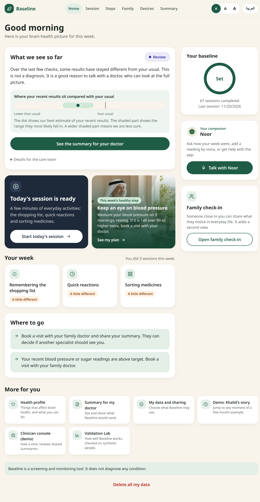
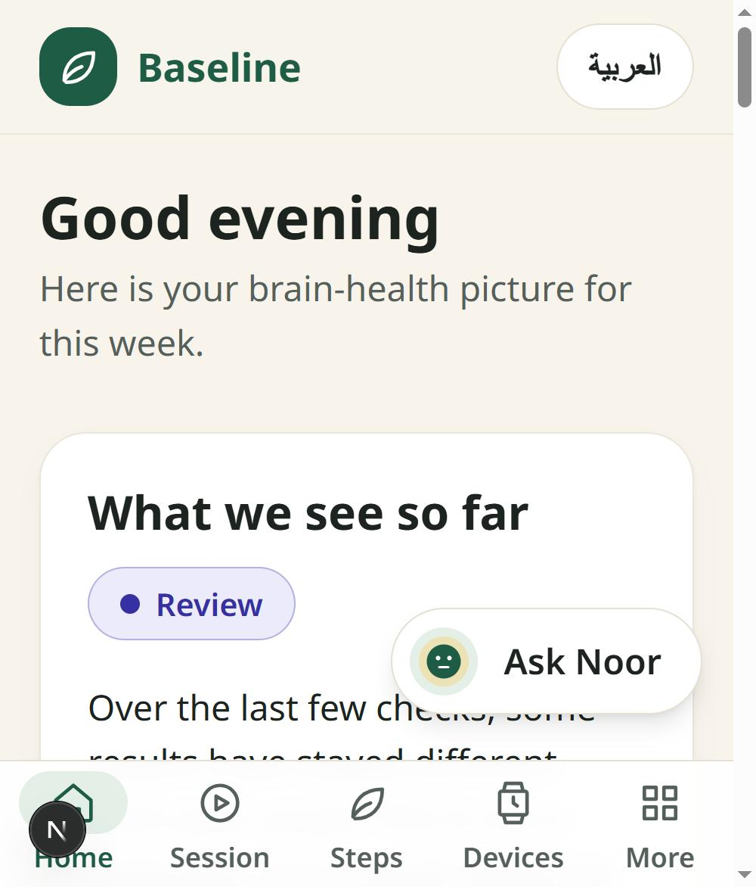
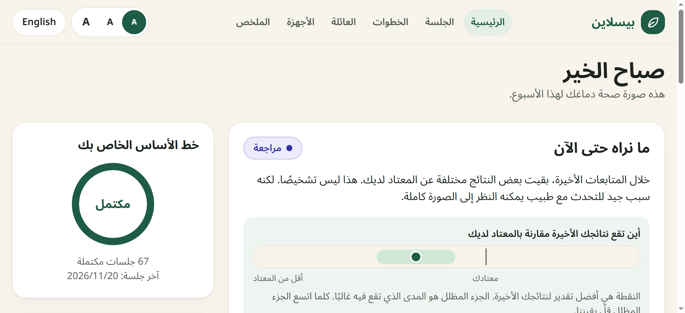
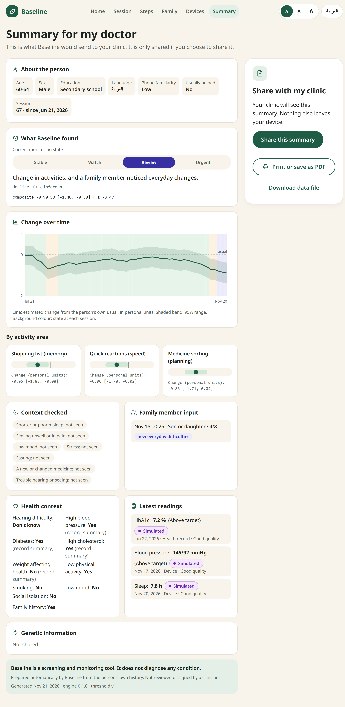
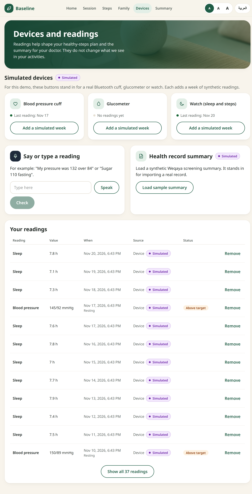
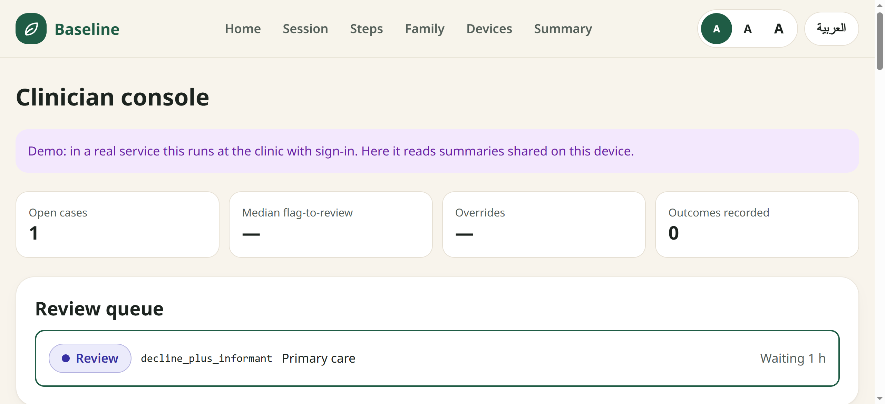
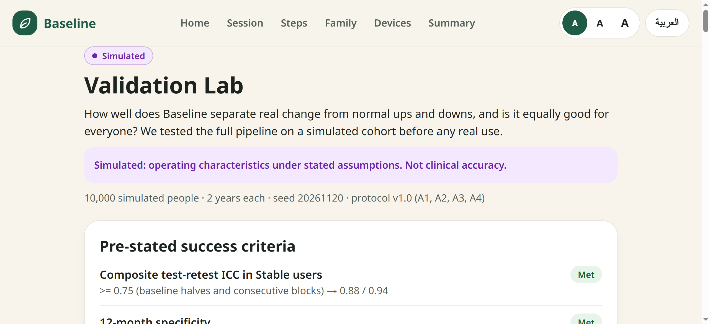
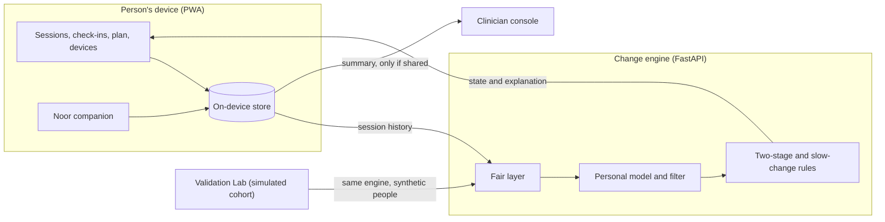

# Baseline

**Know your usual. Notice change early.**

Baseline is a bilingual (Arabic and English) progressive web app that builds a personal brain-health baseline for adults aged 50 and over, separates meaningful change in thinking and everyday function from normal day-to-day variation, and turns what it finds into a clear, safe next step: healthy habits, a short repeat check, a family check-in, or a summary for the family doctor.

It was built for the *Protecting Brain Health Earlier* challenge, with a focus on validation and on fair performance for the local population in the UAE.

> Baseline is a screening and monitoring tool. It does not diagnose any condition. Every person and reading in this repository is synthetic.



---

## Contents

- [The problem](#the-problem)
- [The approach](#the-approach)
- [Product tour](#product-tour)
- [Architecture](#architecture)
- [Validation](#validation)
- [Safety, privacy and fairness](#safety-privacy-and-fairness)
- [Getting started](#getting-started)
- [Repository layout](#repository-layout)
- [Documentation](#documentation)
- [Status and limitations](#status-and-limitations)

---

## The problem

- **Change is noticed late.** At a UAE hospital, people waited an average of 34.7 months from first symptoms to a dementia diagnosis (median 24 months), and the average age at diagnosis was 78 ([evidence register](docs/02-evidence-register.md), A1).
- **Much of the risk is modifiable.** About 45% of dementia is potentially preventable or delayable through 14 risk factors such as high blood pressure, hearing loss, inactivity and social isolation (Lancet Commission 2024, register D1). In Abu Dhabi's Weqaya screening, age-standardised hypertension was 29.2% and diabetes 24.6% (register A3).
- **Population norms fit poorly.** Most cognitive checks compare a person with a population average, mostly built on Western groups and strongly shaped by education and language. A single check can mislabel people and misses slow change in people who start high.

## The approach

Baseline compares each person with their own history.

1. **Set a personal baseline.** Fourteen short sessions of everyday activities: remembering a shopping list, quick reactions, and sorting medicines. Up to two a day, with large text and spoken instructions.
2. **Check in briefly.** A few minutes a day, plus how the person slept and felt, and whether they were ill, stressed or fasting.
3. **Look for real change.** A change engine tracks each activity area with a statistical filter that carries its own uncertainty, and discounts days explained by poor sleep, illness or Ramadan.
4. **Give a clear next step.** Results are shown as plain states, never as scores: **Stable**, **Watch**, **Review** or **Urgent**. Each state has fixed, reviewed wording and one next step.

A **two-stage rule** keeps false alarms low. One unusual day only triggers a few repeat checks (Watch). A doctor visit (Review) is suggested only when the change persists across independent repeat checks, or when a family member also reports everyday changes. A **slow-change rule** catches gradual drift that never crosses the line on a single day.

## Product tour

### Home

The dashboard shows what Baseline sees so far with an uncertainty range, today's session, this week's healthy step, the week by activity area, where to go next, baseline progress, the Noor companion and the family check-in.

| Desktop | Phone (installable PWA) |
|---|---|
|  |  |

On phones the app installs to the home screen and uses a bottom tab bar, large touch targets and three text sizes. The layout is fully right-to-left in Arabic:



### Summary for the doctor

A one-page packet the person chooses to share: the current monitoring state, the rule that led to it, the trajectory over time, change by activity area with uncertainty, context checked (sleep, illness, mood, fasting, medicines), family input, health context and latest readings. It is clearly marked as prepared automatically and not signed by a clinician.



### Devices and readings

Blood pressure, blood sugar, sleep and steps, entered by voice, typed, imported from a health-record summary, or added from a device. In the prototype the devices are simulated, and every simulated reading is labelled.



### Clinician console

Clinics see why each referral was suggested, record a decision and the outcome, and track time from flag to review and how often clinicians override the suggestion.



### Validation Lab

The full pipeline, tested on a simulated cohort before any real use, with pre-stated success criteria and a public record of what passed and what did not.



### Noor, the companion agent

Noor (or Rashid, if the person prefers) explains results in plain language, records readings and check-ins by voice or text, and points to the right screen. It works through a fixed tool contract with reviewed reply templates; red-flag symptoms go straight to emergency guidance (998). A language model may only rephrase a reply that contains no identifiable health data, and the rephrasing is rejected if it changes the meaning.

### Also included

- **Healthy-steps plan:** weekly goals built on modifiable risk factors, with Ramadan-aware wording.
- **Health profile:** the Lancet 2024 risk factors and family history, with "Don't know" always allowed.
- **Family check-in:** a short questionnaire for someone close to the person.
- **My data and sharing:** per-purpose consent, a pilot-week data export, and one-tap deletion.
- **Khalid's story:** a five-month synthetic demo, from baseline through a week of poor sleep and Ramadan to a family check-in and a clinic review.

## Architecture



| Component | Responsibility | Stack |
|---|---|---|
| `web/` | Installable PWA in Arabic and English with offline app shell, on-device storage, Noor, clinician console and Lab viewer | Next.js 16, React 19, TypeScript, Tailwind CSS 4 |
| `engine/` | Fair layer, personal baseline, local-level filter, composite with uncertainty, context discounting, two-stage gate and slow-change (CUSUM) rule, REST API | Python 3.11, FastAPI, NumPy, SciPy |
| `lab/` | Cohort generator, threshold sweep, fairness and item-bias analysis, ablations, held-out confirmation, report writer, pilot-week analysis | Python 3.11, uses `engine` |

## Validation

The Validation Lab follows 10,000 simulated people for two years, with realistic dropout, bad days, Ramadan, and differences in education and phone familiarity; 635 of them develop a slow decline. Success criteria were written down before the run, and every later change to the analysis is recorded as a numbered amendment.

| Pre-stated criterion | Target | Result | Met |
|---|---|---|---|
| Retest reliability (ICC) in Stable users | at least 0.75 | 0.88 / 0.94 | Yes |
| 12-month specificity | at least 0.95 | 0.974 | Yes |
| False referrals per 1,000 person-years | at most 30 | 25.3 | Yes |
| Two-stage vs one-stage rule | fewer false referrals; at most 30 days extra delay | 25.3 vs 58.7; +12 days | Yes |
| Item bias check (3 biased items planted per task) | at least 2 of 3 found; at most 5% false flags | 3 of 3 in both tasks; 0 false flags | Yes |
| Fairness across groups | sensitivity gap at most 0.10; false-referral ratio at most 1.5 | gap 0.12; ratio 1.47 | **No** |

At the chosen threshold, 12-month sensitivity to simulated decline is 0.326 (95% interval 0.291 to 0.361), 47.7% of Review suggestions reflect true change, and the median lead time from onset to Review is 256 days.

The education fairness gap is not yet closed. Five candidate fixes were tested; the best narrowed the gap but, when re-checked on a fresh held-out cohort, broke the false-referral limit, so it was not adopted (amendment A5). For context, a published smartphone study of 290 adults aged 61 to 97 reported retest reliability above 0.85 and about 80% adherence within week-long bursts (register B13).

These are operating characteristics of simulated people under stated assumptions, not clinical accuracy. See the full [validation report](docs/validation-report.md) and the [pre-registered protocol](docs/validation-protocol.md).

## Safety, privacy and fairness

- **Screening, not diagnosis.** Baseline suggests when to talk to a doctor; the doctor decides.
- **Context before alarm.** Sleep, illness, stress, fasting and new medicines are checked before anything is raised.
- **Data stays on the device** unless the person turns on sharing for a specific purpose, and can be deleted in one tap.
- **No identifiable health data is sent to a language model.**
- **Plain language.** User-facing wording follows written [copy guidelines](docs/copy-guidelines.md); people see states and next steps, not raw scores.
- **Compared with yourself.** The person is the reference, and the Lab reports results by age, education and phone familiarity.
- **Accessible.** Arabic and English with right-to-left layout, three text sizes, spoken instructions, hearing and vision checks at the start, and an assisted mode for a relative to help.
- **Cite or cut.** Every number in the product and documentation traces to the [evidence register](docs/02-evidence-register.md) or the validation report.

## Getting started

### Prerequisites

- Node.js 20 or later
- Python 3.11

### Web app

```powershell
cd web
npm install
npm run dev
```

Open http://localhost:3000. It redirects to `/ar` or `/en` based on the browser language. The service worker registers only in production builds (`npm run build` then `npm run start`).

### Change engine

One shared virtual environment at the repository root serves the engine and the Lab:

```powershell
python -m venv .venv
.\.venv\Scripts\python -m pip install -e "engine[api,dev]" -e lab
.\.venv\Scripts\uvicorn baseline_engine.api:app --reload --port 8000
```

The web app reaches the engine through `/api/engine/*` (set `ENGINE_URL` to point elsewhere). Without the engine, sessions still work and are kept on the device.

### Try the demo

Open **Demo: Khalid's story** from the home screen and load any of the six moments. Each replaces the data on the device with Khalid's synthetic history and opens the relevant screen.

### Validation Lab

```powershell
.\.venv\Scripts\python -m baseline_lab.run          # full run: 10,000 people, seed 20261120
.\.venv\Scripts\python -m baseline_lab.run --fast   # quick development run, not reportable
```

Results are written to `lab/outputs/`, copied to `web/public/lab/` for the in-app viewer, and summarised in `docs/validation-report.md`.

### Tests

```powershell
.\.venv\Scripts\python -m pytest engine lab   # engine and Lab
cd web
npm run test:noor                             # Noor red-team suite
npm run test:demo                             # Khalid demo story
npx tsc --noEmit                              # type check
npm run lint
```

## Repository layout

```
Baseline/
├── web/      Progressive web app (Next.js)
├── engine/   Change engine and API (Python, FastAPI)
├── lab/      Validation Lab (Python)
└── docs/     Plan, evidence, protocol, report, screenshots and solution brief
```

## Documentation

| Document | Purpose |
|---|---|
| [Project guide](docs/PROJECT-GUIDE.md) | Complete description of how every part works |
| [Project overview](docs/00-project-overview.md) | Goals, scope and users |
| [Evidence register](docs/02-evidence-register.md) | Every external figure, with source and verification status |
| [Decisions log](docs/03-decisions-log.md) | Design decisions and open questions |
| [Validation protocol](docs/validation-protocol.md) | Pre-registered criteria and amendments A1 to A5 |
| [Validation report](docs/validation-report.md) | Latest Lab results, including failures |
| [Pilot protocol](docs/pilot-protocol.md) | Proposed first pilot with real participants |
| [Data contracts](docs/data-contracts.md) | Shapes of the data passed between parts |
| [Copy guidelines](docs/copy-guidelines.md) | Rules for user-facing wording |
| [Demo script](docs/demo-script.md) | Walkthrough for the live demo |
| [Solution brief (PDF)](docs/Baseline-Solution-Brief.pdf) | Six-page summary of the idea |

## Status and limitations

Baseline is a **working prototype**.

- There are no real users yet; every result comes from synthetic people under written assumptions.
- The education fairness criterion is not met.
- Long-term use is the hardest part: in the simulation many people stop using the app, and most missed declines are among them.
- Device connections are simulated, and the clinician console runs on the same device for demonstration.

The next step is a small, consented pilot week to check that real sessions, completion and reliability match the simulation's assumptions, followed by work with a primary-care partner on the doctor summary and on recording outcomes.
